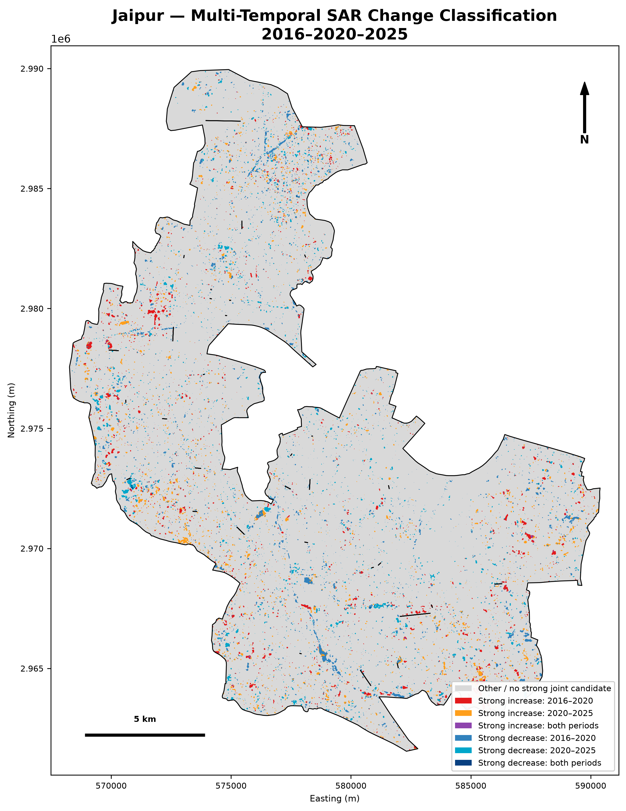
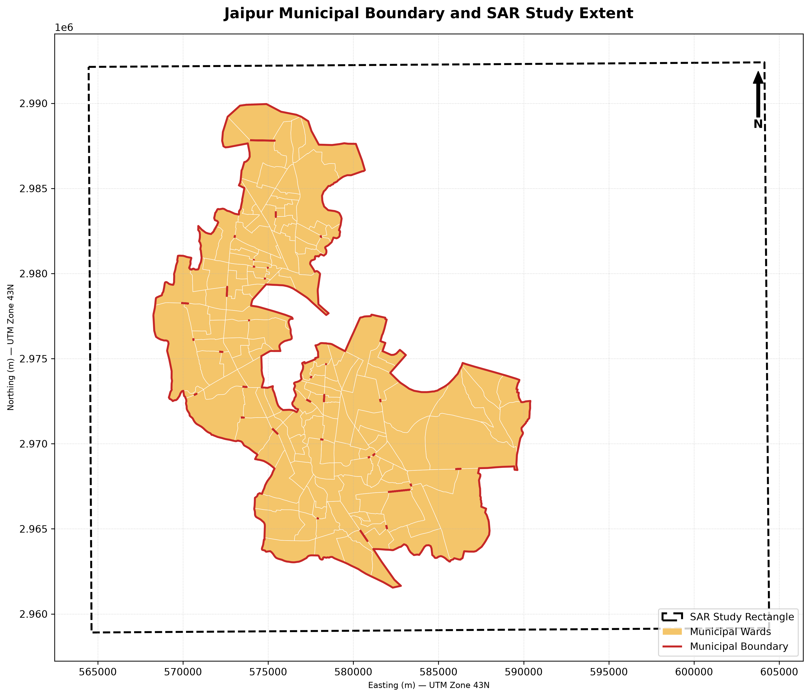
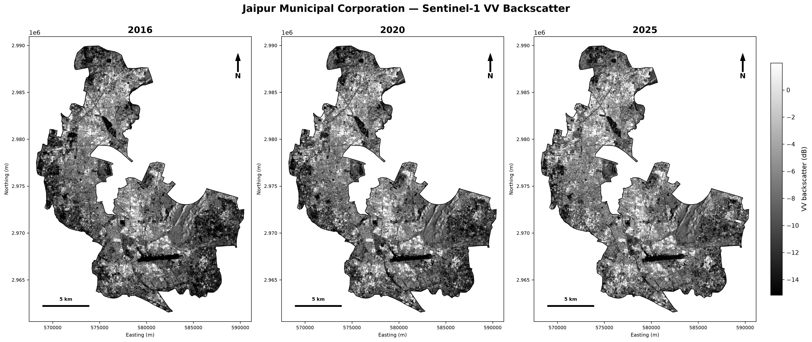
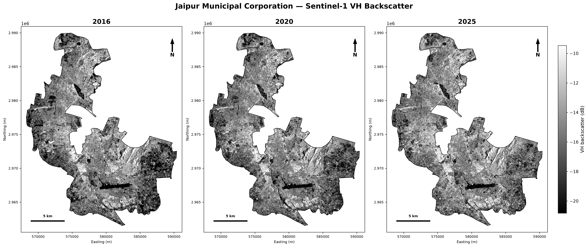
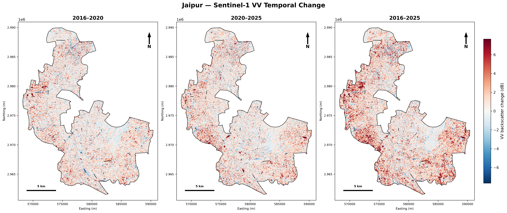
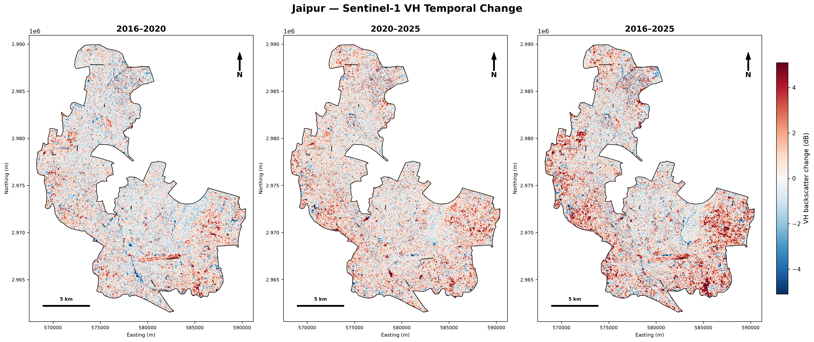
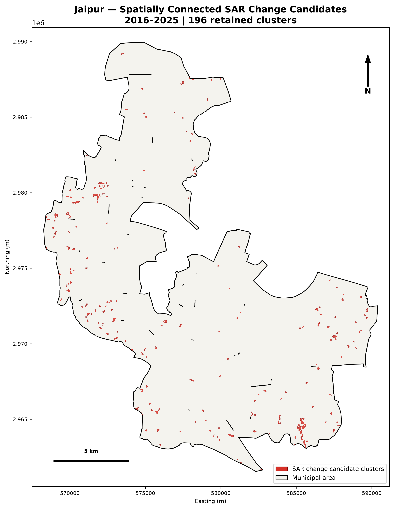
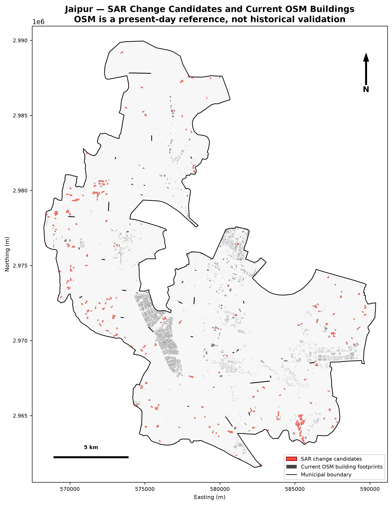
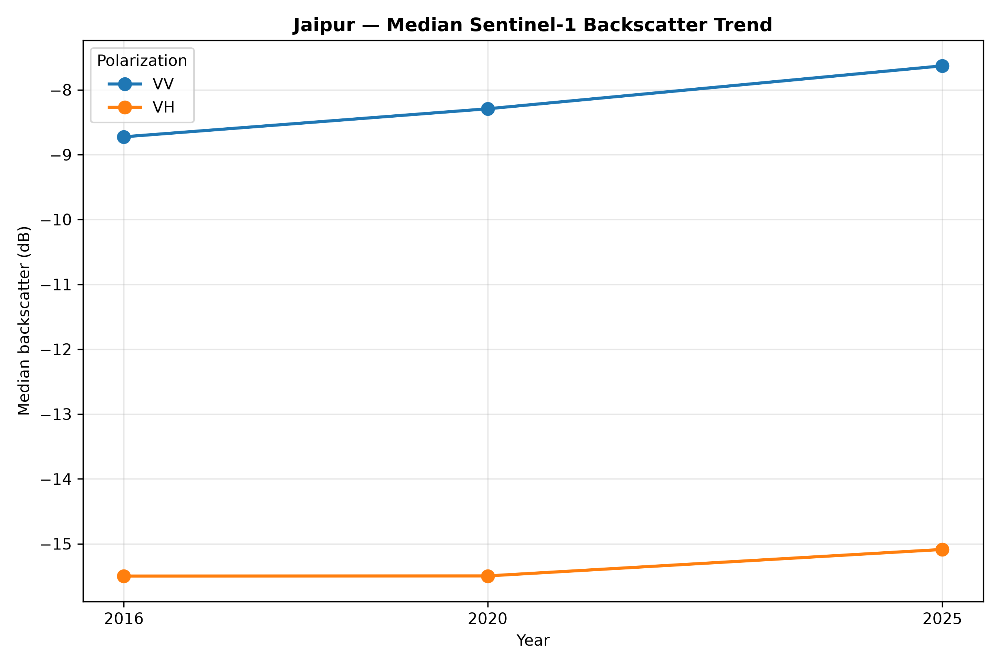
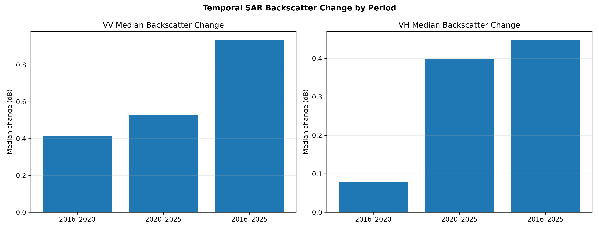

# Jaipur SAR-Based Urban Expansion Analysis

<p align="center">
  <strong>Multi-temporal Sentinel-1 SAR backscatter analysis of Jaipur, Rajasthan, India</strong><br>
  <em>2016 · 2020 · 2025</em>
</p>

<p align="center">
  
</p>

---

## Project Overview

This project investigates multi-temporal surface changes across Jaipur, Rajasthan, using dual-polarization Sentinel-1 Synthetic Aperture Radar (SAR) observations acquired in March 2016, March 2020 and March 2025.

The workflow processes VV and VH backscatter data, aligns the observations to a common spatial grid, derives SAR features, identifies areas with strong backscatter-change signals, groups spatially connected candidates, and compares the candidate areas with contemporary OpenStreetMap (OSM) reference features.

The analysis is designed as a reproducible remote-sensing research workflow using ESA SNAP, Python and QGIS.

> **Important interpretation limitation:** The current outputs identify SAR backscatter-change candidates. They do not constitute a validated built-up/non-built-up classification and do not, on their own, establish actual urban expansion or a validated urban growth rate. Current OSM data are used as contemporary reference information, not as historical ground truth for 2016 or 2020.

## At a Glance

| Item | Description |
|---|---|
| Study area | Jaipur Municipal Corporation, Rajasthan, India |
| Study period | 2016–2025 |
| Satellite | Sentinel-1A |
| Sensor | C-band Synthetic Aperture Radar |
| Acquisition mode | Interferometric Wide Swath (IW) |
| Product | Ground Range Detected High Resolution (GRDH) |
| Polarizations | VV and VH |
| Acquisition dates | 2 March 2016; 5 March 2020; 3 March 2025 |
| Relative orbit | 136 |
| Orbit direction | Descending |
| Primary processing software | ESA SNAP 14 |
| Analysis tools | Python, GeoPandas/raster workflows, QGIS |
| Aligned raster CRS | WGS 84 / UTM Zone 43N (EPSG:32643) |
| Aligned pixel size | 10 m |

## Study Area

The analysis uses a rectangular geographic processing window covering the Jaipur study region:

| Boundary | Coordinate |
|---|---:|
| North | 27.05° N |
| South | 26.75° N |
| West | 75.65° E |
| East | 76.05° E |

The municipal boundary used in the analysis was assembled from a 150-ward source and subjected to geometry checks. The dissolved municipal area recorded in the project is approximately **278.35 km²**.

The rectangular SAR processing extent and the municipal boundary are different spatial objects: the rectangle defines the processing window, while the municipal polygon defines the area used for municipal statistics.

<p align="center">
  
</p>

## Research Objectives

1. Prepare comparable Sentinel-1 VV and VH datasets for three acquisition years.
2. Assess raster quality, spatial coverage, NoData behaviour and common valid footprint.
3. Examine temporal variation in VV and VH backscatter.
4. Derive dual-polarization SAR features and a multi-year feature stack.
5. Identify pixels with strong joint VV/VH backscatter-change responses.
6. Group spatially connected change candidates into clusters.
7. Compare candidate clusters with contemporary OSM building-footprint data.
8. Document limitations and define the validation required before making urban-expansion claims.

## Data Sources

### Sentinel-1 SAR

Three Sentinel-1A IW GRDH dual-polarization products were used:

| Year | Acquisition date | Product identifier |
|---|---|---|
| 2016 | 2 March 2016 | `S1A_IW_GRDH_1SDV_20160302T005217_20160302T005242_010183_00F074_C380` |
| 2020 | 5 March 2020 | `S1A_IW_GRDH_1SDV_20200305T005233_20200305T005258_031533_03A1F5_7036` |
| 2025 | 3 March 2025 | `S1A_IW_GRDH_1SDV_20250303T005248_20250303T005313_058133_072E2C_6B0E` |

The original SAFE products are retained under `data/raw/`. Their complete directory structures should be preserved.

### OpenStreetMap Reference Data

The original OSM reference data are stored as:

`data/raw/Jaipur_India_Rajasthan_Reference.gpkg`

The clipped reference dataset used for spatial comparison is:

`data/processed/OSM_Jaipur_Clipped_Reference.gpkg`

The source dataset contained 145,169 records across 10 layers. The clipped dataset retained 140,644 records.

OSM data are subject to the Open Database License (ODbL). Appropriate attribution is required. OSM completeness and historical availability are not assumed.

## Methodology

### 1. Sentinel-1 preprocessing

The intended SNAP preprocessing sequence was:

1. Apply Orbit File.
2. Radiometric calibration to Sigma0.
3. Lee Sigma speckle filtering.
4. Range-Doppler terrain correction.
5. Geographic subsetting to the Jaipur processing window.
6. Separate VV and VH GeoTIFF export.

Recorded Lee Sigma settings for the 2016 processing were: 7 × 7 window, one look, sigma 0.9 and target window 3 × 3. The same settings were intended for the other dates; exact parameter consistency should not be treated as independently verified without complete saved processing records.

### 2. Band extraction and spatial alignment

VV and VH bands were extracted into separate single-band rasters. The six rasters were then aligned to a common projected grid.

| Grid property | Recorded value |
|---|---:|
| CRS | EPSG:32643 |
| Pixel size | 10 m |
| Width | 3,993 pixels |
| Height | 3,349 pixels |
| Number of aligned rasters | 6 |

### 3. Raster quality and common footprint

The workflow examined raster dimensions, coordinate reference systems, pixel values, NoData footprints, processing records and spatial coverage.

The common valid footprint contains **13,202,823 pixels**, approximately **98.73%** of the full rectangular grid.

The municipal coverage analysis reported 100% valid aligned raster-mask coverage within the municipal polygon for the analysed dates. This describes the aligned raster mask and is not independent proof of complete original satellite observation coverage.

### 4. SAR feature engineering

Annual VV and VH rasters were used to derive:

- Dual-polarization total-backscatter feature.
- VV/VH ratio feature.
- Multi-year feature stack.

The 15-band feature stack is stored at:

`data/processed/sar_features/Jaipur_SAR_Feature_Stack_2016_2025.tif`

Refer to the feature-engineering scripts for the exact band order and calculation definitions.

### 5. Temporal backscatter analysis

Pixel-wise differences were examined for:

- 2016–2020
- 2020–2025
- 2016–2025

The analysis describes changes in radar backscatter response. Backscatter can also respond to vegetation, soil moisture, surface roughness, land management and acquisition conditions. A positive backscatter difference is therefore not uniquely attributable to new construction.

### 6. Change-candidate detection

Continuous VV and VH difference rasters were generated for each comparison period. Candidate masks were derived using the project's selected joint VV/VH thresholding approach.

For the 2016–2025 comparison, the recorded joint 95th-percentile increase thresholds were approximately:

- VV: **5.866 dB**
- VH: **3.916 dB**

These thresholds identify strong joint backscatter increases under this workflow. They are not a land-cover classifier.

### 7. Spatial clustering

Spatially connected candidate pixels were grouped into clusters. The retained cluster set used a minimum area threshold of 0.5 ha.

### 8. OSM comparison

The cluster outputs were compared spatially with current OSM building footprints. This comparison is exploratory and does not provide historical validation or a classification accuracy estimate.

## Key Results

### Temporal backscatter statistics

Recorded median backscatter changes:

| Comparison period | VV median change | VH median change |
|---|---:|---:|
| 2016–2020 | +0.412 dB | +0.079 dB |
| 2020–2025 | +0.529 dB | +0.399 dB |
| 2016–2025 | +0.935 dB | +0.448 dB |

The median VV and VH changes are positive for all three comparison periods. These values describe the change in the aligned backscatter datasets and should not be interpreted directly as urban growth.

### Joint change candidates and clusters

| Metric | Recorded result |
|---|---:|
| Retained spatial clusters | 196 |
| Minimum retained cluster area | 0.5 ha |
| Combined retained cluster area | 2.3042 km² |
| Mean cluster area | 1.1756 ha |
| Median cluster area | 0.86 ha |
| Largest cluster | 6.17 ha |
| Cluster area as a share of municipal area | Approximately 0.83% |

The combined cluster area is the mapped area of retained SAR change candidates under the selected thresholds. It is **not** a measured built-up area increase.

### OSM comparison

Recorded current OSM building-footprint coverage within the municipal area was approximately **5.8275 km²** (2.0936% of the municipal area). The recorded overlap between retained clusters and OSM building footprints was approximately **0.03294 km²**, or 1.43% of the retained cluster area.

This overlap is not an accuracy metric. It may reflect OSM completeness, mapping date, the difference between radar response and building footprints, and the exploratory nature of the candidate mask.

## Selected Results and Figures

### Multi-year VV and VH backscatter

<p align="center">
  
</p>

<p align="center">
  
</p>

### Temporal change maps

<p align="center">
  
</p>

<p align="center">
  
</p>

### Spatial change clusters

<p align="center">
  
</p>

### Comparison with OSM building footprints

<p align="center">
  
</p>

### Statistical summary

<p align="center">
  
</p>

<p align="center">
  
</p>

*Figures are referenced using repository-relative paths. Keep these report images in the repository at the listed locations for them to render on GitHub.*

## Repository Structure

```text
Project_02_Jaipur_SAR_Urban_Expansion/
│
├── README.md
├── .gitignore
│
├── data/
│   ├── raw/
│   │   ├── README.md
│   │   ├── Jaipur_India_Rajasthan_Reference.gpkg
│   │   └── Sentinel-1 SAFE products/
│   │
│   ├── processed/
│   │   ├── README.md
│   │   ├── aligned_utm43n/
│   │   ├── common_footprint/
│   │   ├── sar_features/
│   │   └── change_detection/
│   │
│   └── boundaries/
│
├── notebooks/
│   └── Jaipur_SAR_Urban_Expansion_Phasewise_Analysis.ipynb
│
├── scripts/
│   ├── 01_validate_sar_rasters.py
│   ├── ...
│   └── 40_generate_jaipur_temporal_change_visualization.py
│
├── reports/
│   ├── boundary_analysis/
│   ├── change_detection/
│   ├── final_maps_v2/
│   ├── final_results/
│   ├── final_statistics_v2/
│   ├── final_temporal_change_analysis/
│   ├── osm_quality_analysis/
│   ├── quality_analysis/
│   ├── sar_coverage_analysis/
│   └── sar_feature_analysis/
│
└── qgis/
    └── Jaipur_SAR_Urban_Expansion.qgz
```

Large source and processed rasters are maintained outside ordinary Git version control. The directory tree above is a logical overview; local storage may contain additional large files excluded from GitHub.

## Running the Workflow

### Requirements

- Python 3
- ESA SNAP 14 for Sentinel-1 preprocessing
- QGIS for GIS inspection and map review
- The Python packages imported by the project scripts

Use the project's virtual environment where available.

### Run the phase-wise notebook

Open:

`notebooks/Jaipur_SAR_Urban_Expansion_Phasewise_Analysis.ipynb`

Set the notebook's `PROJECT_DIR` to the repository root if it is not already running from that directory. Execute phases in order and inspect each phase's outputs before continuing.

### Run individual scripts

The numbered Python scripts are stored in `scripts/`. Run them from the project root so that their relative paths resolve correctly.

Example:

```bash
python scripts/01_validate_sar_rasters.py
```

The workflow should be run sequentially because later stages depend on outputs from earlier stages.

## Limitations

The following limitations are important when interpreting the findings:

1. **Backscatter is not a unique urban indicator.** VV and VH responses can change due to multiple surface and environmental factors.
2. **No validated built-up classification has been completed.** The current candidate masks are threshold-based SAR change products.
3. **OSM is not historical ground truth.** Contemporary building footprints cannot independently validate historical change in 2016 or 2020.
4. **OSM completeness is uncertain.** Missing mapped buildings may affect spatial overlap results.
5. **Processing reproducibility has limits.** Some intermediate SNAP products were removed. Available processing records should be distinguished from settings that were intended but not independently verified.
6. **Municipal boundary provenance matters.** The boundary source and its validation limitations should be considered when interpreting municipal area statistics.

## Future Work

The next research stage should focus on validation before reporting urban expansion measurements:

- Acquire comparable historical optical imagery or authoritative built-up reference data.
- Develop a defensible built-up/non-built-up classification.
- Prepare independent reference samples for each relevant period.
- Assess classification performance using a documented sampling design and confusion matrix.
- Estimate built-up area and urban expansion rates only after validation.
- Investigate candidate clusters with high-resolution imagery and local reference information.
- Evaluate sensitivity to threshold selection and alternative change-detection methods.

## Data Attribution

- **Sentinel-1:** Copernicus Sentinel-1 mission.
- **Processing software:** European Space Agency, SNAP.
- **OpenStreetMap:** © OpenStreetMap contributors, distributed under the Open Database License (ODbL).

Consult the source providers' terms and include required attribution when redistributing data or derived products.

## Project Status

**Current status:** Multi-temporal SAR preprocessing, feature generation, backscatter-change analysis, spatial clustering and exploratory OSM comparison completed.

**Not yet completed:** Independent historical validation and validated urban expansion estimation.

---

## Author and Project Information

**Project:** Jaipur SAR-Based Urban Expansion Analysis  
**Domain:** Remote Sensing · SAR · GIS · Geospatial Data Analysis  
**Study Area:** Jaipur, Rajasthan, India  
**Study Period:** 2016–2025  
**Primary Data:** Sentinel-1A VV/VH  
**Software:** ESA SNAP 14 · Python · QGIS

*This repository documents a research workflow and its current analytical outputs. Interpret candidate change areas within the methodological limitations described above.*
